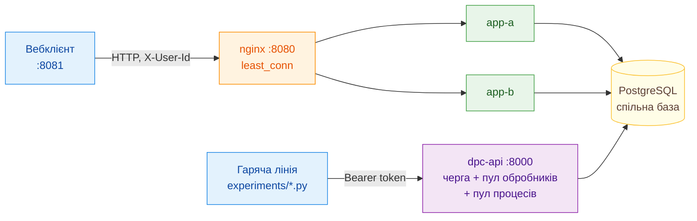
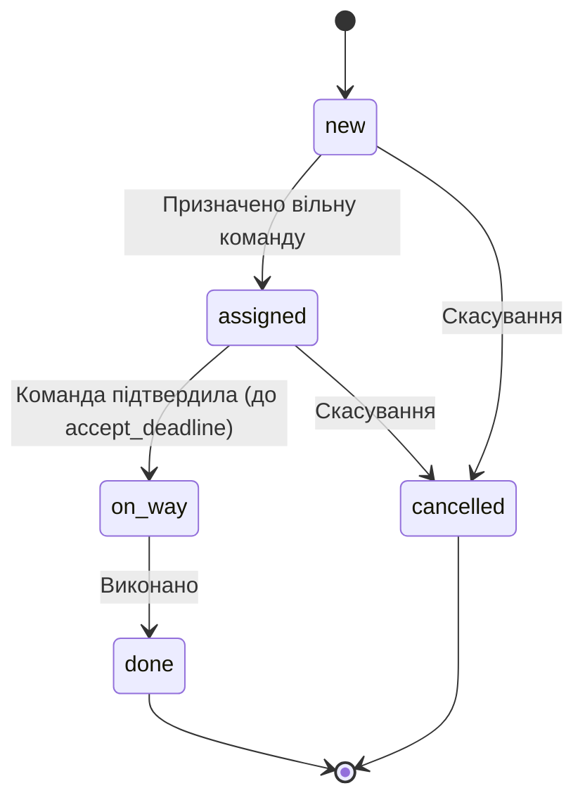
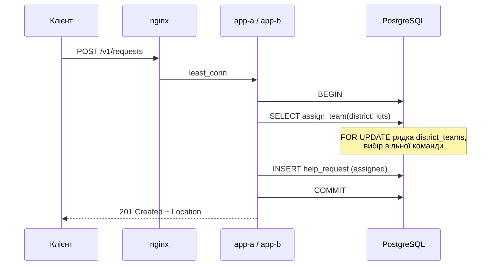
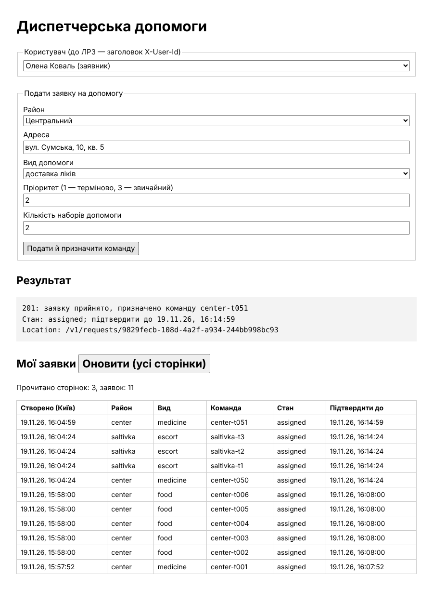
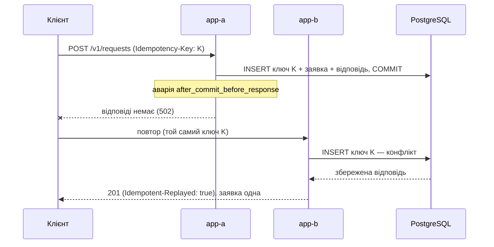
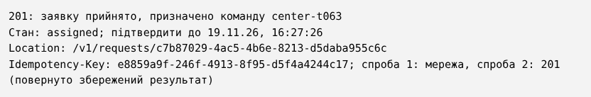
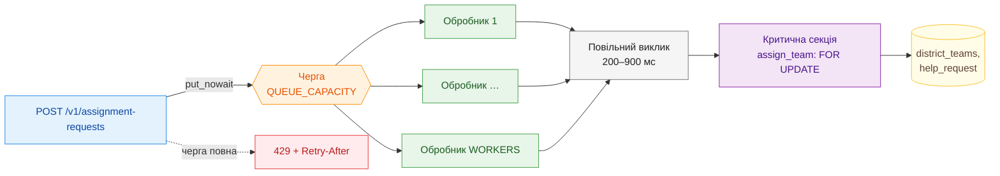
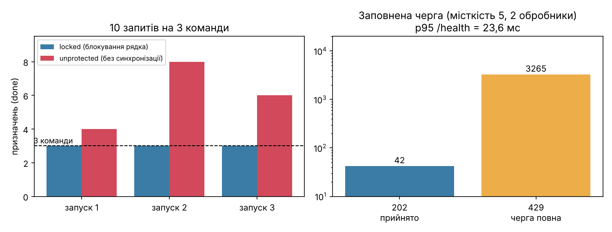

# C30 - Диспетчерська допомоги

> Структура - за `README-template.md` обох курсів. Опис наданих каркасів - [web/KIT-README.md](web/KIT-README.md),
> [dpc/KIT-README.md](dpc/KIT-README.md). Повні результати й механізм кожної ЛР - `results/<частина>-lrN/README.md`.

Спільний навчальний проєкт з дисциплін:
- "Обмін даними у Web-застосунках";
- "Розподілені та паралельні обчислення".

## 1. Курс і тема

Ідентифікатор теми: C30

Назва теми: «Диспетчерська допомоги».

Автори:
- Малюта Артем, ст. гр. ІТІН-23-2.

Виконано: ЛР1 обох дисциплін, Web ЛР2.

## 2. Проєкт

Метою проєкту є розроблення системи диспетчерської допомоги: люди подають
заявки на допомогу (доставка ліків, супровід, продукти), а диспетчерська
призначає вільну волонтерську команду району.

Заявки із сайту приймає частина Web, дзвінки на гарячу лінію — черга
частини DPC. Обидва канали застосовують те саме предметне правило.

Основні ролі:
- заявник (`user`);
- диспетчер (`staff`).

Спільним ресурсом є волонтерські команди району.

Основні інваріанти:
- Команда виконує одну заявку.
- Видано наборів допомоги не більше, ніж є на складі команди.
- Зайнятих команд району не більше, ніж команд на чергуванні.

Повільний виклик: «зв'язок із командою» тривалістю 200–900 мс.

Команда підтверджує призначення за 10 хвилин; заявка рівно на межі
строку переходить іншій команді.

Розрахунок ЛР2: інтеграл інтенсивності заявок λ(t) = A·t·e^(−t/τ)
за перші T годин після події (злива, морози) — кількість заявок, з якої
разом із середнім часом виконання визначають потрібну кількість команд у зміні.

## 3. Архітектура

Проєкт складається з двох взаємопов'язаних частин: Web та DPC, які працюють
з однією базою PostgreSQL.



### Web

Відповідає за приймання заявок із сайту, призначення вільної команди,
перегляд власних заявок і взаємодію з користувачем. Два екземпляри сервера
(`app-a`, `app-b`, FastAPI) працюють за балансувальником nginx; стан — лише в базі.

### DPC

Відповідає за приймання дзвінків гарячої лінії в обмежену чергу, оброблення
їх пулом обробників із повільним викликом, захист ресурсу команд і паралельний
чисельний розрахунок (ЛР2).

### Спільний проєкт

#### Розподіл відповідальності

Web створює заявки каналу `web` (сайт). DPC створює заявки каналу `hotline`
(гаряча лінія). Кожен запит обробляє лише його канал.

Ресурс (команди району) обидві частини змінюють тільки через функцію БД
`assign_team()`: блокування рядка `district_teams`, вибір вільної команди
й зміна лічильника виконуються атомарно в транзакції того, хто викликає.
Додатковий захист — частковий унікальний індекс `help_request_one_active_per_team`.

#### Спільні ідентифікатори

- `request_id` — ідентифікатор заявки (запит DPC = id заявки `help_request`);
- `team_id` — ідентифікатор команди;
- `district_id` — район.

Ключ предметного ефекту — `request_id`. Для повторних HTTP-запитів Web
використовує заголовок `Idempotency-Key`.

#### Взаємодія компонентів

Web приймає заявку через `POST /v1/requests` і одразу повертає `201` з
призначеною командою або `409`, якщо вільних команд немає.

DPC приймає дзвінок через `POST /v1/assignment-requests` до обмеженої черги
та повертає `202 Accepted`. Результат читається через
`GET /v1/assignment-requests/{id}`, стан ресурсу — `GET /v1/district-teams/{id}`.

На ЛР1–ЛР2 частини взаємодіють через спільну базу. Події Kafka (`team-status`)
і показ статусу команд у Web додаються в ЛР4–ЛР5.

#### Оброблення відмов

Повторна передача того самого `request_id` у DPC повертає `409` і не створює
другої заявки. Повтор запиту Web з тим самим `Idempotency-Key` повертає
збережену відповідь, навіть якщо попередній процес аварійно завершився після
фіксації транзакції.

#### Наскрізний сценарій

1. Заявник подає заявку через Web (або телефонує на гарячу лінію — DPC).
2. Web (DPC) у транзакції викликає `assign_team()` для району.
3. Функція блокує рядок району, знаходить вільну команду й позначає її зайнятою.
4. Створюється заявка в стані `assigned` з `accept_deadline = created_at + 10 хв`.
5. Клієнт показує призначену команду; заявка з'являється у списку «Мої заявки».
6. Якщо вільних команд немає — Web відповідає `409`, DPC переводить запит у `rejected`.

## 4. Структура репозиторію

| Шлях | Призначення |
|---|---|
| `compose.yaml`, `.env.example` | спільний стенд обох частин |
| `migrations/` | спільні міграції PostgreSQL |
| `web/server/`, `web/openapi.yaml` | сервер Web (FastAPI) і контракт |
| `web/client/` | клієнт Web (HTML + JavaScript, поза Compose) |
| `dpc/api/`, `dpc/openapi.yaml` | сервіс DPC (черга, пул обробників, розрахунок ЛР2) і контракт |
| `configs/nginx/` | балансувальник `least_conn` |
| `experiments/` | сценарії дослідів |
| `results/` | виводи перевірок і дослідів за ЛР, `results/<частина>-lrN/README.md` - докладно |
| `docs/` | рішення й модель області, зміни плану, вимоги й стан пунктів |
| `checks.yaml` | налаштування засобу перевірки |
| `web/KIT-README.md`, `dpc/KIT-README.md` та решта `web/`, `dpc/` | комплекти курсів (конфігурації пізніших ЛР, інструменти) |

## 5. Збирання й запуск

### Вимоги до середовища

- Docker Desktop (Compose v2), ≈ 2 ГБ пам'яті, увімкнена віртуалізація
- Python 3.12+ (сценарії дослідів)
- Node.js 22 (тест повторів клієнта)
- Git
- Вільні порти: 8080, 8001, 8002, 8000, 5432

### Запуск системи

Усі команди виконуються з кореневого каталогу проєкту.

#### Windows (PowerShell)

```powershell
Copy-Item .env.example .env
docker compose up -d --build
```

#### Windows (cmd)

```cmd
copy .env.example .env
docker compose up -d --build
```

#### macOS / Linux (Terminal)

```bash
cp .env.example .env
docker compose up -d --build
```

Міграції й тестові дані застосовує сервіс `migrate` під час запуску.

### Запуск клієнта

```bash
python -m http.server 8081 --bind 127.0.0.1 --directory web/client
```

### Адреси сервера

- Web через nginx: http://localhost:8080
- Web напряму: http://localhost:8001 (app-a), http://localhost:8002 (app-b)
- Health: http://localhost:8080/health, http://localhost:8000/health
- DPC: http://localhost:8000 (токен `dev-token`)
- Клієнт: http://localhost:8081

Тестові користувачі (заголовок `X-User-Id`): `u-applicant-1`, `u-applicant-2`, `u-dispatcher`.

### Сценарії дослідів

```bash
python -m pip install httpx "psycopg[binary]"
python experiments/web_lr1_scenario.py
```

Режими DPC задаються в `.env` (`RESOURCE_MODE`, `QUEUE_CAPACITY`, `WORKERS`) з
перезапуском `docker compose up -d dpc-api`. Усі перевірки однією командою:
`sh experiments/run_all.sh`.

## 6. Лабораторні роботи

Стан пунктів - [docs/requirements-web.md](docs/requirements-web.md), [docs/requirements-dpc.md](docs/requirements-dpc.md);
зміни плану - [docs/plan-changes.md](docs/plan-changes.md); стан етапів - [docs/project-status.md](docs/project-status.md).

### 6.1. Обмін даними у Web-застосунках

#### ЛР1. Контракт, модель і перша операція

| Пункт | Де реалізовано | Перевірка та свідчення |
|---|---|---|
| О1.1. Модель предметної області | розділ нижче, [docs/decisions.md](docs/decisions.md) | Описано сутності, стани, дозволені переходи, інваріанти та числові навчальні припущення |
| О1.2. Схема бази даних | `migrations/001_core.sql` | PK/FK, NOT NULL, CHECK, UNIQUE, частковий унікальний індекс інваріанта, `timestamptz` |
| О1.3. Контракт API | `web/openapi.yaml` | `npx @redocly/cli lint web/openapi.yaml` — valid; приклади normal/scarce/missing |
| О1.4. Головна операція | `web/server/app/requests_api.py` | Транзакція: район → `assign_team` → INSERT; 201 + Location після фіксації; 400/422/404/409 — `results/web-lr1/scenario.json` (14/14) |
| О1.5. Список із курсором | `requests_api.py::list_requests` | Порядок `(created_at, id)`, limit 1–50, непрозорий курсор, пошкоджений — 400; читання сторінками без пропусків і повторів |
| О1.6. Система, перевірка живучості й журнал | `compose.yaml`, `configs/nginx/`, `middleware.py` | `/health` на кожному екземплярі; `X-Request-ID`; рядок JSON із time, instance, route, status, duration_ms |
| О1.7. Клієнт | `web/client/` | Подання заявки, показ команди, Problem Details, читання всіх сторінок (рисунок 1) |
| Д1.1. Правило за часом | `timerules.py`, `web/server/tests/` | 5 тестів: межа строку, зміщення зони |

Докладно: [results/web-lr1/README.md](results/web-lr1/README.md).

##### О1.1. Модель предметної області

Система «Диспетчерська допомоги» дозволяє заявникам подавати заявки на допомогу,
а диспетчерській — призначати вільні волонтерські команди району.

**Основні сутності:**

| Сутність | Призначення |
|---|---|
| `AppUser` | Користувач із роллю `user` (заявник) або `staff` (диспетчер) |
| `District` | Район, назва часової зони |
| `Team` | Волонтерська команда району зі складом наборів допомоги |
| `DistrictTeams` | Ресурс району: команд на чергуванні й зайнято |
| `HelpRequest` | Заявка на допомогу |

**Стани заявки:**



**Інваріанти:**

- Команда виконує не більше однієї активної заявки (`assigned` або `on_way`).
- Набори допомоги видаються не більше, ніж є на складі команди.
- Зайнятих команд району не більше, ніж команд на чергуванні.

**Навчальні припущення:**

| Параметр | Значення |
|---|---|
| Строк підтвердження | 10 хв, інтервал `[created_at, accept_deadline)` |
| Пріоритет | 1–3 (1 — терміново) |
| Набори допомоги | цілі 0–20 на заявку |
| Час | `timestamptz`, показ у зоні Europe/Kyiv |
| Команди | `center` — 500; `saltivka`, `test-race`, `test-unprotected` — по 3 |

Атрибути сутностей, ER-діаграма та правила переходів: [docs/decisions.md](docs/decisions.md), розділ «Модель предметної області».

##### О1.4. Головна операція





*Рисунок 1 — вебклієнт: заявку створено, команду призначено, усі сторінки списку прочитано.*

#### ЛР2. Конкуренція та повторення запитів

| Пункт | Де реалізовано | Перевірка та свідчення |
|---|---|---|
| О2.1. Інваріант за одночасних запитів | `assign_team()` — блокування рядка `district_teams` + унікальний індекс | 5 раундів «10 заявок на 3 команди» через app-a й app-b: щоразу 3×201, 7×409, 3 різні команди, busy = 3 — `results/web-lr2/race.json` |
| О2.2. Механізм ідемпотентності | `web/server/app/idempotency.py`, `migrations/003_idempotency.sql` | Без ключа — 400; повтор через інший екземпляр — та сама відповідь; інше тіло — 422; ключ обробляється — 409 з Retry-After; 5 одночасних дублікатів — одна заявка; 1200 прострочених ключів прибрано порціями по 500 |
| О2.3. Повтор після втраченої відповіді | `fault("after_commit_before_response")` | Повтор через app-b повертає збережений 201, заявка одна — `results/web-lr2/lost-response.json` |
| О2.4. Повторні спроби в клієнті | `web/client/api.js::callWithRetry`, `web/client/tests/retry.test.mjs` | Аварія → 502 → повтор із тим самим ключем → збережений 201; сервер недоступний → «результат невідомий» (рисунок 2) |

Докладно: [results/web-lr2/README.md](results/web-lr2/README.md).

**Чому блокування рядка (О2.1).** Правило «є вільна команда району» стосується кількох рядків
(лічильник району й команди), тому атомарний умовний `UPDATE` одного рядка його не охоплює, а
серіалізовна транзакція вимагала б повторів. `SELECT … FOR UPDATE` рядка `district_teams`
серіалізує призначення лише в межах району й однаково працює з обох екземплярів Web і з DPC.





*Рисунок 2 — перша спроба втрачена через аварію, повтор із тим самим ключем повернув збережений результат.*

#### ЛР3. Вхід і доступ

| Пункт | Де реалізовано | Перевірка та свідчення |
|---|---|---|
| | | |

#### ЛР4. Довгі операції, події й зовнішня система

| Пункт | Де реалізовано | Перевірка та свідчення |
|---|---|---|
| | | |

#### ЛР5. Сповіщення через WebSocket

| Пункт | Де реалізовано | Перевірка та свідчення |
|---|---|---|
| | | |

#### ЛР6. Зміна системи та поступове оновлення

| Пункт | Де реалізовано | Перевірка та свідчення |
|---|---|---|
| | | |

### 6.2. Розподілені та паралельні обчислення

#### ЛР1. Сервіс із чергою та модель виконання

| Пункт | Де реалізовано | Перевірка та свідчення |
|---|---|---|
| О1.1. Приймання запитів | `dpc/api/app/assign.py`, `migrations/002_dpc_queue.sql` | 202 до завершення; стани queued → processing → done / rejected / failed |
| О1.2. Обмежена черга й перевантаження | `asyncio.Queue(maxsize=QUEUE_CAPACITY)`, `put_nowait` | Дослід «Заповнена черга»: 429 з Retry-After, черга ≤ 5, p95 `/health` = 23,6 мс |
| О1.3. Пул обробників | `assign.py::start`, `worker` | Рівно `WORKERS` задач; повільний виклик — `await asyncio.sleep`, не блокує приймання |
| О1.4. Захист спільного ресурсу | `change_locked` (транзакція + `FOR UPDATE`), `change_unprotected` | 10 запитів на 3 команди: locked — 3 done / 7 rejected; unprotected — 4–8 done, одна команда на 2–3 заявках (рисунок 3) |
| О1.5. Час виконання й метрики | `Timing`, `/metrics` | Позначки монотонного годинника, `queue_wait / processing / delivery_wait`, перевірка порядку; `queue_length`, `processing`, `rejected`, `full_ms_p50/p95/p99` |

Докладно: [results/dpc-lr1/README.md](results/dpc-lr1/README.md).





*Рисунок 3 — 10 запитів на 3 команди (з блокуванням і без) та заповнена черга.*

#### ЛР2. Паралельний чисельний розрахунок

| Пункт | Де реалізовано | Перевірка та свідчення |
|---|---|---|
| | | |

#### ЛР3. Розподілена обробка в Ray і відновлення

| Пункт | Де реалізовано | Перевірка та свідчення |
|---|---|---|
| | | |

#### ЛР4. Пакетний звіт у Spark

| Пункт | Де реалізовано | Перевірка та свідчення |
|---|---|---|
| | | |

#### ЛР5. Потокова обробка, запізнення й відновлення

| Пункт | Де реалізовано | Перевірка та свідчення |
|---|---|---|
| | | |

#### ЛР6. Координація виконавців

| Пункт | Де реалізовано | Перевірка та свідчення |
|---|---|---|
| | | |

## 7. Досліди

Режими з вимкненим захистом запускаються на окремих тестових даних (район `test-unprotected`).

| Дослід | Режим і команда | Що видно / посилання на результат |
|---|---|---|
| Сценарій Web ЛР1 | `python experiments/web_lr1_scenario.py` | 14/14 перевірок, усі сторінки списку без пропусків і повторів — `results/web-lr1/scenario.json` |
| 10 заявок на 3 команди (Web О2.1) | `python experiments/web_lr2_race.py --rounds 5` | Щоразу 3×201, 7×409, обидва екземпляри — `results/web-lr2/race.json` |
| Ідемпотентність (Web О2.2–О2.3) | `python experiments/web_lr2_idempotency.py` | 400 / 201+replay / 422 / 409 / одна заявка на 5 дублікатів; після аварії app-a повтор через app-b — збережений 201 |
| Повтори клієнта (Web О2.4) | `node web/client/tests/retry.test.mjs` | 502 → 201 з тим самим ключем; «результат невідомий» після 4 спроб — `results/web-lr2/client-retry.txt` |
| 10 дзвінків на 3 команди (DPC О1.4) | `WORKERS=10`; `python experiments/dpc_lr1_race.py --district test-race`, потім `RESOURCE_MODE=unprotected` і `--district test-unprotected` | locked: 3/7 у 3 запусках; unprotected: 4, 8, 6 призначень на 3 команди |
| Заповнена черга (DPC О1.2) | `QUEUE_CAPACITY=5 WORKERS=2`; `python experiments/dpc_lr1_queue_full.py --clients 30 --seconds 10` | 42×202, 3265×429 (усі з Retry-After), max черга 5, `/health` p50 17,1 мс, p95 23,6 мс |

Умови, прогноз, вимірювання й висновки кожного досліду - у `results/<ЛР>/README.md`.

## 8. Межі гарантій і керовані відмови

Керовану відмову Web ЛР2 `after_commit_before_response` увімкнено; підсумок меж - після виконання решти дослідів.

Керована відмова Web ЛР2 `after_commit_before_response`:

| Дія | Команда |
|---|---|
| Увімкнення | `docker compose exec app-a touch /faults/after_commit_before_response` |
| Перевірка спрацювання | `docker compose logs app-a \| grep fault.hit` |
| Відновлення | Docker перезапускає процес (`restart: unless-stopped`); прапорець одноразовий |

## 9. Внесок учасників

| Учасник | Реалізовані пункти й виконані досліди |
|---|---|
| Малюта Артем | Web ЛР1 (О1.1-О1.7, Д1.1), Web ЛР2 (О2.1-О2.4), DPC ЛР1 (О1.1-О1.5) |

### Використані бібліотеки

| Бібліотека | Для чого використана | Місце застосування |
|---|---|---|
| FastAPI, Pydantic | HTTP-маршрути, перевірка вхідних даних | `web/server/app/requests_api.py`, `dpc/api/app/assign.py`, `compute.py` |
| Uvicorn | Запуск серверів | `web/server/Dockerfile`, `dpc/api/Dockerfile` |
| Psycopg 3 | З'єднання з PostgreSQL, транзакції | `requests_api.py`, `idempotency.py`, `assign.py` |
| asyncio, concurrent.futures, multiprocessing | Черга, обробники, пул процесів, спільна сума | `assign.py`, `compute.py`, `integral.py` |
| Каркаси комплектів курсів | Журнал JSON, Problem Details, `/health`, `/metrics`, керовані відмови | `web/server/app/*`, `dpc/api/app/*` |
