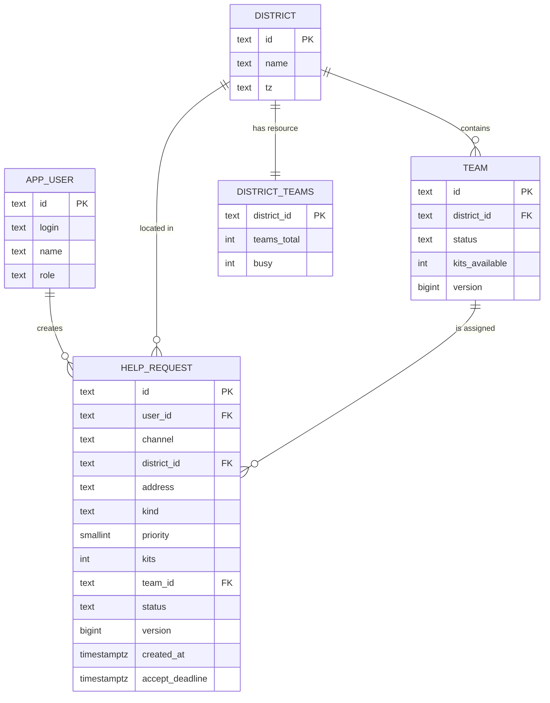
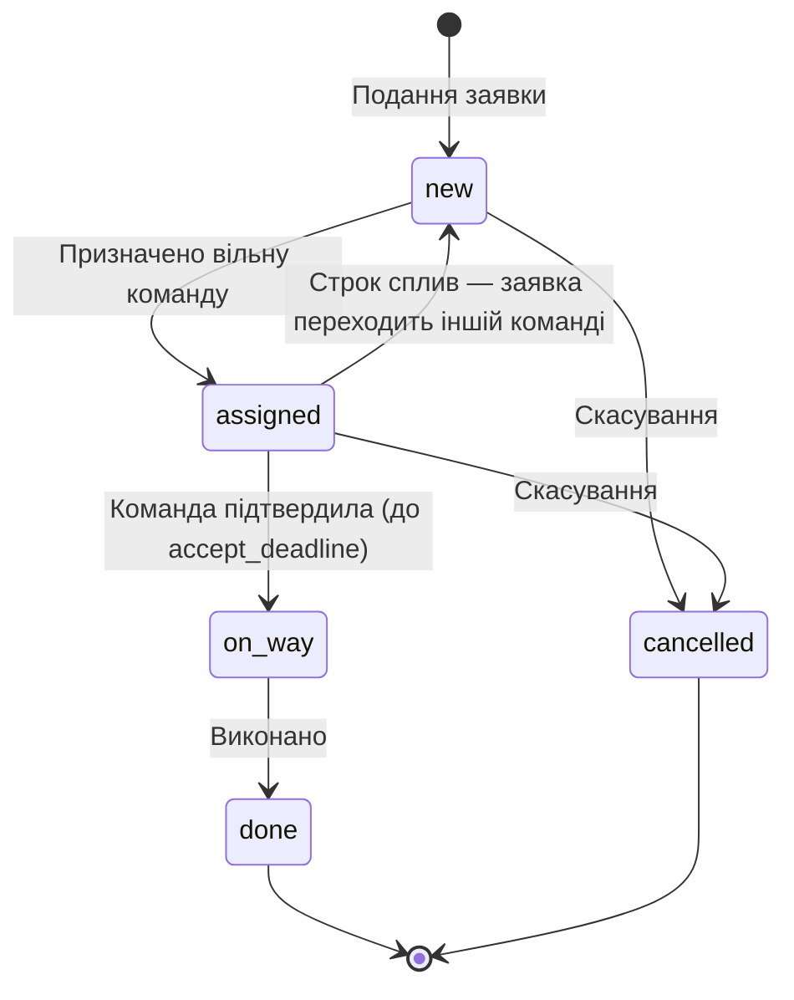
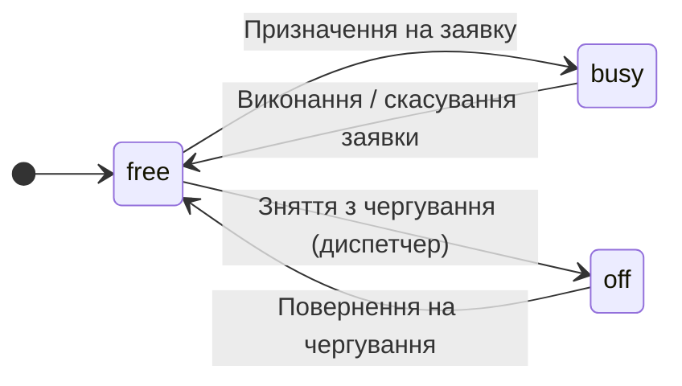

# Рішення проєкту C30 «Диспетчерська допомоги»

Прийняті рішення; переглядаються лише окремим записом із датою та причиною.
Джерело: методички обох курсів і комплекти викладача.

## Архітектура й стек

| № | Рішення | Причина |
|---|---|---|
| A1 | Web-сервер - Python/FastAPI з каркаса Web (`web/server`) | готові журнал JSON, Problem Details, `/health`, керовані відмови |
| A2 | DPC api - Python/FastAPI з каркаса DPC (`dpc/api`) | черга й пул обробників на `asyncio`, процеси для ЛР2 |
| A3 | Клієнт - HTML + JavaScript у `web/client/`, поза Compose (`python -m http.server 8081`) | клієнт звертається до Web лише через nginx; для ЛР1-ЛР2 достатньо без збирання |
| A4 | Дві частини з окремими API: Web через nginx `:8080` (`least_conn`, два екземпляри), DPC api `:8000` | у ЛР2 повтор після аварії має пройти через інший екземпляр |
| A5 | Одна база PostgreSQL і одна папка `migrations/` зі спільною нумерацією | обидві частини змінюють один ресурс |
| A6 | Один `compose.yaml` у корені | менше розбіжностей між частинами |

## Межа станів Web ↔ DPC

| № | Рішення |
|---|---|
| B1 | Спільний ресурс - команди району (`district_teams`, `team`). Змінюється лише функцією БД `assign_team(district, kits)` |
| B2 | Заявки каналу `web` створює Web, каналу `hotline` - DPC; кожен запит обробляє лише його канал |
| B3 | Ключ предметного ефекту - `request_id`; для HTTP-повторів Web - `Idempotency-Key` |
| B4 | До ЛР4 частини взаємодіють лише через базу, Kafka не використовується |

## Web

| № | Рішення | Причина |
|---|---|---|
| M1 | Призначення команди - `assign_team()`: `SELECT … FOR UPDATE` рядка `district_teams`, вибір вільної команди, зміна лічильника в транзакції викликача | правило охоплює кілька рядків, атомарний `UPDATE` одного рядка його не покриває; SERIALIZABLE вимагав би повторів |
| M2 | Другий захист інваріанта - частковий унікальний індекс `help_request_one_active_per_team` | помилка коду не порушить «одна команда - одна заявка» |
| M3 | Список із непрозорим курсором за `(created_at, id)`, limit 1-50 | сторінки без пропусків і повторів за однакового `created_at` |
| M4 | Правило за часом - чиста функція, поточний час передається параметром; рівно межа `accept_deadline` = строк минув | перевіряється тестами без годинника |
| M5 | Ідемпотентність: `Idempotency-Key` обов'язковий, відбиток - SHA-256 канонічного JSON, ключ і заявка в одній транзакції; повтор з іншим тілом - 422, ключ в обробленні - 409 з `Retry-After`; прострочені ключі прибираються порціями (`SKIP LOCKED`) | повтор після втраченої відповіді повертає збережений результат |
| M6 | Помилки - Problem Details (RFC 9457) | єдиний формат для клієнта й засобу перевірки |
| M7 | Користувач - заголовок `X-User-Id` | автентифікація з'являється в ЛР3 |
| M8 | Клієнт повторює той самий запит з тим самим ключем: експоненційна пауза, повний jitter, не раніше `Retry-After`; після вичерпання спроб - «результат невідомий» | не створити другу заявку |

## DPC

| № | Рішення | Причина |
|---|---|---|
| P1 | Обмежена черга `asyncio.Queue(maxsize)`, `put_nowait`; повна черга - 429 з `Retry-After`; прийнятий запит - 202 + `Location` | перевантаження не блокує приймання й `/health` |
| P2 | Пул з `WORKERS` задач; повільний виклик (200-900 мс) - `await asyncio.sleep` поза критичною секцією | блокування рядка триває мілісекунди |
| P3 | Критична секція - транзакція БД з `FOR UPDATE`, а не `asyncio.Lock` | у ЛР3 оброблення переходить в інші процеси |
| P4 | Режим `unprotected` для досліду на окремому районі `test-unprotected` | показати порушення інваріанта без захисту |
| P5 | Час запиту - позначки монотонного годинника; `queue_wait`, `processing`, `delivery_wait` | порядок позначок перевіряється |
| P6 | ЛР2: `ProcessPoolExecutor`, індекси `[0, n)` ділять на суміжні діапазони, частини об'єднуються за номерами; еталон - первісна `F(b) - F(a)`, допуск 10⁻⁶ | результат не залежить від кількості процесів |
| P7 | Режими спільної суми `none` / `lock` / `local` | показати гонку, її захист і локальні суми |

---

# Модель предметної області (О1.1)

### 1. Загальна інформація

- Тема: C30 - «Диспетчерська допомоги».
- Дисципліна: «Обмін даними у Web-застосунках» (спільний проєкт із «Розподілені та паралельні обчислення»).

### 2. Опис предметної області

Система призначена для приймання заявок на допомогу та призначення
волонтерських команд.

Заявники подають заявки (доставка ліків, супровід, продукти) через сайт
або телефонують на гарячу лінію. Диспетчерська призначає вільну команду
району; команда підтверджує призначення, їде на адресу й виконує заявку.

Диспетчер контролює чергування команд і може зняти команду з чергування.

Спільними ресурсами системи є:

- волонтерські команди району;
- набори допомоги на складі кожної команди.

Основна складність системи - одночасні заявки багатьох людей після події
(злива, морози), які надходять двома каналами (сайт і гаряча лінія) та через
різні екземпляри сервера: одна команда не може поїхати на дві заявки.

### 3. Ролі користувачів

| Роль | Ідентифікатор | Можливості |
|---|---|---|
| Заявник | `user` | Подання заявки, перегляд власних заявок, зміна адреси, скасування |
| Диспетчер | `staff` | Перегляд стану команд, зняття команди з чергування |

### 4. Сутності предметної області

#### 4.1. AppUser - користувач

Представляє користувача системи.

| Атрибут | Тип | Опис |
|---|---|---|
| `id` | text | Ідентифікатор |
| `login` | text | Унікальний логін |
| `name` | text | Ім'я |
| `role` | text | `user` або `staff` |

#### 4.2. District - район

| Атрибут | Тип | Опис |
|---|---|---|
| `id` | text | Ідентифікатор району |
| `name` | text | Назва |
| `tz` | text | Назва часової зони (Europe/Kyiv) — окремо від моментів часу |

#### 4.3. Team - волонтерська команда

| Атрибут | Тип | Опис |
|---|---|---|
| `id` | text | Ідентифікатор команди |
| `district_id` | text | Район команди |
| `status` | text | `free`, `busy`, `off` |
| `kits_available` | integer | Наборів допомоги на складі (ціле ≥ 0) |
| `version` | bigint | Версія запису |

#### 4.4. DistrictTeams - ресурс району

| Атрибут | Тип | Опис |
|---|---|---|
| `district_id` | text | Район |
| `teams_total` | integer | Команд на чергуванні |
| `busy` | integer | Зайнятих команд |

#### 4.5. HelpRequest - заявка на допомогу

| Атрибут | Тип | Опис |
|---|---|---|
| `id` | text | Ідентифікатор (спільний з DPC — `request_id`) |
| `user_id` | text | Заявник (для гарячої лінії може бути порожнім) |
| `channel` | text | `web` (сайт) або `hotline` (гаряча лінія) |
| `district_id` | text | Район |
| `address` | text | Адреса, 3–300 символів |
| `kind` | text | `medicine`, `escort`, `food`, `other` |
| `priority` | smallint | 1–3 (1 — терміново) |
| `kits` | integer | Потрібна кількість наборів 0–20 |
| `team_id` | text | Призначена команда |
| `status` | text | Стан заявки |
| `version` | bigint | Версія запису |
| `created_at` | timestamptz | Момент створення |
| `accept_deadline` | timestamptz | Строк підтвердження командою |

### 5. Зв'язки між сутностями

- Один район містить багато команд.
- Кожна команда належить одному району.
- Одна команда протягом часу може мати багато заявок, але одночасно — не більше однієї активної.
- Кожна заявка належить одному району й (для каналу `web`) одному заявнику.
- Один заявник може створювати багато заявок.

#### ER-діаграма



### 6. Стани заявки

| Стан | Опис |
|---|---|
| `new` | Заявку прийнято, команду ще не призначено |
| `assigned` | Команду призначено, очікується підтвердження до `accept_deadline` |
| `on_way` | Команда підтвердила й прямує на адресу |
| `done` | Заявку виконано |
| `cancelled` | Заявку скасовано |

#### 6.1. Дозволені переходи заявки



Стани `done` та `cancelled` є кінцевими.

Головна операція створює заявку одразу в стані `assigned`, якщо вільна команда є;
інакше повертається `409`, і заявка не створюється.
Зміна адреси можлива з перевіркою поточної версії запису (`If-Match`).
Повторне скасування не звільняє команду вдруге.

### 7. Стани команди

| Стан | Опис |
|---|---|
| `free` | Команда на чергуванні й вільна |
| `busy` | Команда виконує заявку |
| `off` | Команду знято з чергування |

#### 7.1. Дозволені переходи команди

Диспетчер може зняти з чергування лише вільну команду.



### 8. Інваріанти

Інваріанти - це правила, які повинні виконуватися незалежно від кількості
одночасних запитів і від того, яким каналом надійшла заявка.

#### 8.1. Команда виконує одну заявку

Одна команда не може одночасно мати більше однієї заявки у стані
`assigned` або `on_way`.

```text
active_requests(team_id) <= 1
```

Захист: функція `assign_team()` блокує рядок `district_teams` (`SELECT … FOR UPDATE`),
вибирає вільну команду й позначає її зайнятою в одній транзакції з записом заявки;
частковий унікальний індекс `help_request (team_id) WHERE status IN ('assigned','on_way')`.

#### 8.2. Набори допомоги

Видано наборів не більше, ніж є на складі команди.

```text
0 <= kits_available
kits(request) <= kits_available(team) у момент призначення
```

#### 8.3. Ресурс району

```text
0 <= busy <= teams_total
```

Межу перевіряє `assign_team()` під блокуванням. CHECK `busy <= teams_total` навмисно не
додано: дослід DPC О1.4 без синхронізації має показати порушення (окремий район `test-unprotected`).

### 9. Числові параметри (навчальні припущення)

| Параметр | Значення |
|---|---|
| Строк підтвердження | 10 хв, інтервал `[created_at, accept_deadline)`; рівно на межі — сплив |
| Пріоритет | 1–3, за замовчуванням 2 |
| Набори допомоги | цілі 0–20 на заявку; склад команди — 10–20 |
| Час | `timestamptz`; клієнт показує моменти в зоні Europe/Kyiv |
| Повільний виклик DPC | «зв'язок із командою», 200–900 мс |
| Тестові дані | `center` — 500 команд; `saltivka`, `test-race`, `test-unprotected` — по 3 |
| Інтеграл ЛР2 | λ(t) = A·t·e^(−t/τ), A = 40 заявок/год², τ = 3 год, [0; 12] год |
