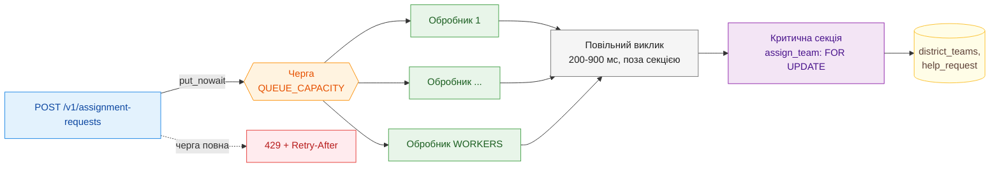
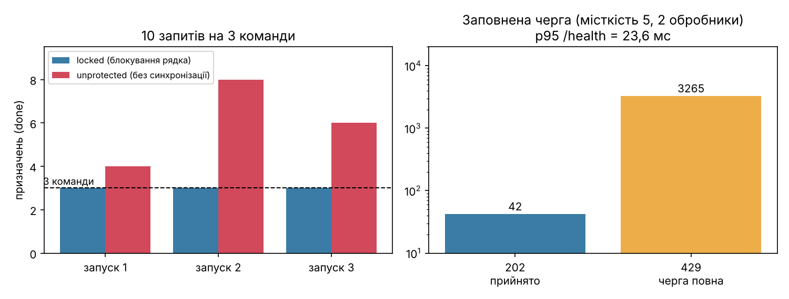

# DPC ЛР1. Сервіс із чергою та модель виконання: докладно

Скорочений опис і таблиця пунктів - [README.md](../../README.md), розділ 6.2. Тут - механізм, повні результати дослідів і межі гарантій.

## Схема



## Механізм

**Черга й очікування обробника.** Черга - `asyncio.Queue(maxsize=QUEUE_CAPACITY)`. Обробник у `await queue.get()`
на порожній черзі віддає керування циклу подій і не займає CPU, доки `put_nowait` не розбудить його. Усі задачі
працюють в одному потоці циклу, тож перевірка місткості й `put_nowait` не перериваються іншою задачею. Черга
повна - `429` з `Retry-After`; прийнятий запит - `202` з `Location`, стан `queued`.

**Критична секція.** Одна транзакція PostgreSQL: `assign_team()` блокує рядок `district_teams`, вибирає вільну
команду, створює заявку й переводить запит у `done` або `rejected`. Повільний виклик «зв'язок із командою»
(200-900 мс) стоїть до транзакції, тож блокування рядка триває мілісекунди. Блокування в базі, а не
`asyncio.Lock`, бо в ЛР3 оброблення переходить в інші процеси. Режим `unprotected` (`RESOURCE_MODE`) читає й
змінює лічильник без блокування - лише на районі `test-unprotected`.

**Час і метрики.** Позначки монотонного годинника `received → started → finished → delivered` дають
`queue_wait`, `processing`, `delivery_wait`; порядок позначок перевіряється. `/metrics`: `queue_length`,
`processing`, `rejected`, `full_ms_p50/p95/p99`.

## Результати

| Дослід | Умови | Результат | Свідчення |
|---|---|---|---|
| 10 дзвінків на 3 команди, захист увімкнено | `WORKERS=10`, район `test-race` | 3 done / 7 rejected у 3 запусках, 3 різні команди | `race-test-race.json` |
| Те саме без захисту | `RESOURCE_MODE=unprotected`, район `test-unprotected` | 4, 8, 6 призначень на 3 команди, одна команда на 2-3 заявках | `race-test-unprotected.json` |
| Заповнена черга | `QUEUE_CAPACITY=5`, `WORKERS=2`, 30 клієнтів, 10 с | 42×202, 3265×429 (усі з `Retry-After`), max черга 5, `/health` p50 17,1 мс, p95 23,6 мс | `queue-full.json` |



## Приклад докладного опису досліду

| Поле | Зміст |
|---|---|
| Пункт і твердження | О1.2. Переповнення черги не блокує `/health`, а відхилені запити не приймаються в оброблення |
| Версія й умови | Linux (KVM), 2 vCPU, 7 ГБ RAM; `QUEUE_CAPACITY=5`, `WORKERS=2`, повільний виклик 200-900 мс |
| Відтворення | 30 клієнтів 10 с подають дзвінки в район `center`; окремий клієнт що 20 мс опитує `/health`, ще один - `/metrics` |
| Прогноз | Довжина черги не більша за 5; повний запит отримує 429 з `Retry-After`; p95 `/health` ≤ 100 мс |
| Вимірювання | 42 × 202, 3265 × 429, найбільша довжина черги 5; 230 звернень до `/health`: p50 17,1 мс, p95 23,6 мс |
| Свідчення | `queue-full.json` |
| Висновок | Черга не перевищила місткості, `/health` вклався в поріг. Це час HTTP-відповіді, а не повний час оброблення (p50 1,9 с) |

## Як відтворити

```bash
WORKERS=10 docker compose up -d dpc-api
python experiments/dpc_lr1_race.py --district test-race
QUEUE_CAPACITY=5 WORKERS=2 docker compose up -d dpc-api
python experiments/dpc_lr1_queue_full.py --clients 30 --seconds 10
```

## Межі

Черга зберігається в пам'яті процесу: після аварії `api` запити в стані `queued` не відновлюються. Повний
запит у черзі - 429, а не очікування. Результати виміряно на 2 vCPU віртуальної машини.
