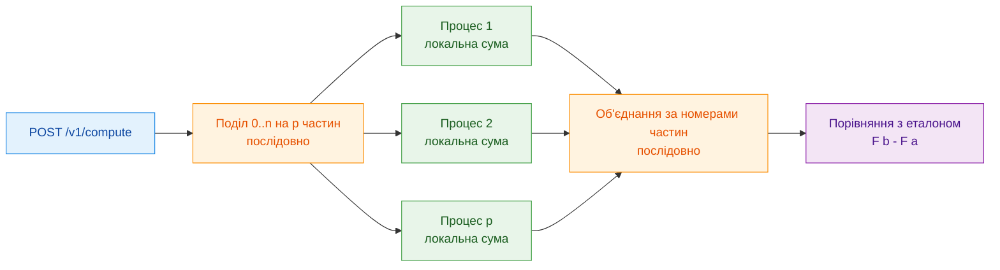
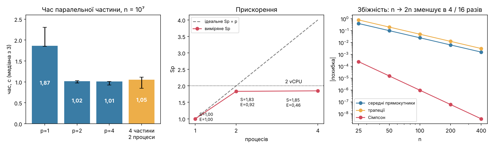

# DPC ЛР2. Паралельний чисельний розрахунок: докладно

Скорочений опис і таблиця пунктів - [README.md](../../README.md), розділ 6.2. Тут - механізм, повні результати й межі.

## Схема



## Механізм

Розраховується інтеграл інтенсивності заявок λ(t) = A·t·e^(−t/τ), A = 40, τ = 3, на [0; 12]. Індекси
`[0, n)` ділять на суміжні діапазони за кількістю процесів `ProcessPoolExecutor`; кожен процес повертає локальну
суму, а `compute.py` об'єднує їх за номерами частин (порядок додавання не залежить від порядку завершення).
Еталон - первісна `F(t) = −Aτ(t + τ)e^(−t/τ)`, значення `F(b) − F(a)`.

**Допуск.** Похибка середніх прямокутників ≤ (b−a)·h²·max|λ''|/24; для n = 10⁷ це ≈ 10⁻¹¹. Похибка округлення
суми 10⁷ доданків у найгіршому випадку ≈ n·ε·|I| ≈ 4·10⁻⁷. Допуск 10⁻⁶ покриває обидві з запасом і не залежить
від кількості процесів.

**Режими спільної суми** (`mode`): `none` - усі процеси додають у спільну змінну без захисту; `lock` - з
блокуванням; `local` - кожен процес накопичує локальну суму, об'єднання в кінці.

## Результати

| Дослід | Результат | Свідчення |
|---|---|---|
| Точність, n = 10⁷, 1/2/4 процеси | 327,0318500003, похибка ≤ 2,1·10⁻¹¹ < 10⁻⁶ | `speedup.json` |
| Збіжність, n = 25…400 | відношення похибок n і 2n: 4,00 (середні прямокутники, трапеції), 16,0 (Сімпсон) | `accuracy.json` |
| Прискорення, 2 vCPU | T1 = 1,87 с; S2 = 1,83 (E = 0,92); S4 = 1,85 (E = 0,46) | `speedup.json` |
| Причина обмеження | py-spy: 99,2 % вибірок - `part_sum`, 0,6 % - цикл подій, 0,2 % - очікування. 4 частини на пулі з 2 процесів - 1,05 с, частка ЦП 1,0: обмеження - кількість ядер | `pyspy-summary.txt`, `pyspy-raw.txt` |
| Спільна сума, n = 4·10⁵, 4 процеси | none: 193,3 / 264,6 / 279,4 замість 327,03; lock: похибка 1,6·10⁻⁹ за 0,7-0,8 с; local: та сама похибка за 0,07 с | `shared-sum.json` |



## Як відтворити

```bash
python experiments/dpc_lr2_speedup.py --n 10000000 --repeats 3
python experiments/dpc_lr2_accuracy.py
python experiments/dpc_lr2_shared_sum.py --n 400000 --repeats 3
```

## Межі

Прискорення виміряно на 2 vCPU віртуальної машини; на більшій кількості ядер 4 процеси дадуть інший результат.
Режим `none` недетермінований: числа в таблиці - три запуски.
