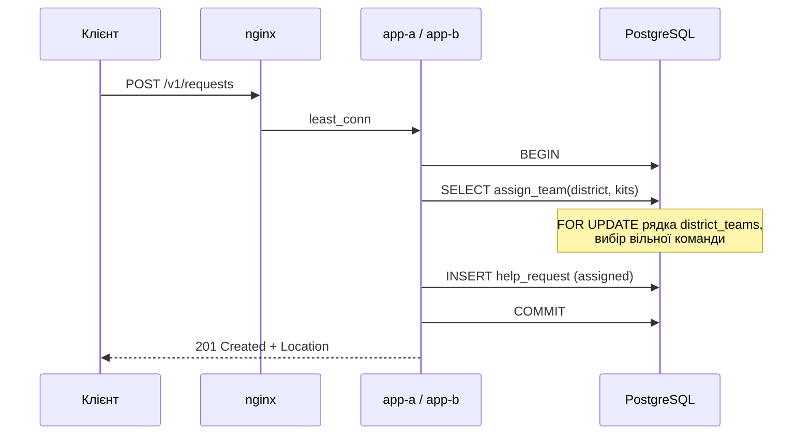
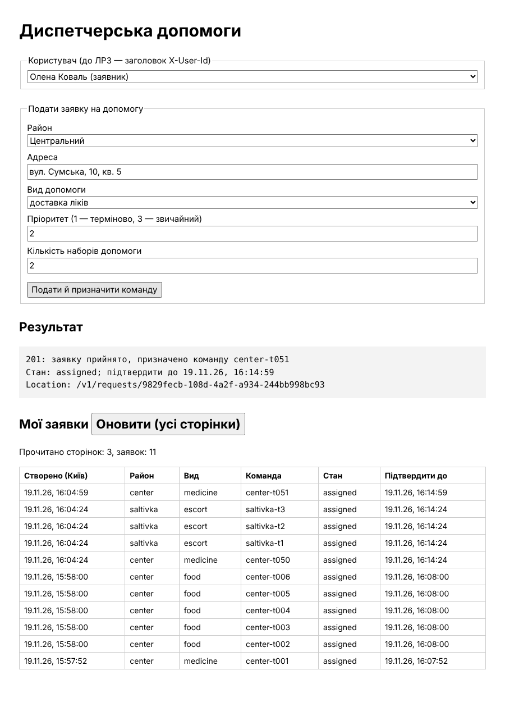
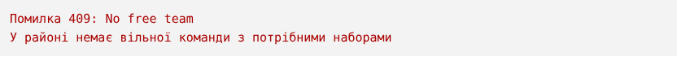
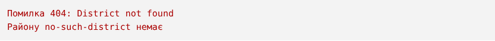

# Web ЛР1. Контракт, модель і перша операція: докладно

Скорочений опис і таблиця пунктів - [README.md](../../README.md), розділ 6.1. Тут - механізм і результати перевірок.

## Головна операція



## Механізм

Усі зміни команд виконує функція БД `assign_team(district, kits)` (`migrations/001_core.sql`): блокує рядок
`district_teams`, вибирає вільну команду з достатнім складом наборів, позначає її зайнятою й збільшує
лічильник `busy`. Заявка вставляється в тій самій транзакції; `201` + `Location` повертається лише після
`COMMIT`. Вільних команд немає - `409` без змін у базі. Другий захист - частковий унікальний індекс
`help_request_one_active_per_team`.

Правило за часом (`web/server/app/timerules.py`) - чиста функція: поточний час передається параметром;
`accept_deadline = created_at + 10 хв`, рівно на межі строк уже минув.

Список заявок (`GET /v1/requests`) - за порядком `(created_at, id)`, `limit` 1-50, курсор непрозорий
(base64 від пари), пошкоджений курсор - `400`. Помилки - Problem Details.

## Результати

| Перевірка | Результат | Свідчення |
|---|---|---|
| Сценарій головної операції | 14/14: 201 + `Location`; читання за `Location` 200; чужа заявка 404; пошкоджений JSON 400; неправильні дані й невідоме поле 422; немає району 404; без `X-User-Id` 401; четверта заявка в район із 3 командами 409 | `scenario.json` |
| Список із курсором | сторінки без пропусків і повторів; пошкоджений курсор 400; `limit` = 51 - 422 | `scenario.json` |
| Тести правила за часом | 5 passed: межа строку, зміщення зони | `web/server/tests/test_timerules.py` |
| `redocly lint web/openapi.yaml` | valid | - |



*Заявку створено, команду призначено, усі сторінки списку прочитано.*



*Вільних команд немає: відповідь 409 показана як Problem Details.*



*Невідомий район: 404.*

## Як відтворити

```bash
docker compose up -d --build
python -m pip install httpx "psycopg[binary]"
python experiments/web_lr1_scenario.py
```

## Межі

Користувач визначається заголовком `X-User-Id` без перевірки (автентифікація - ЛР3). Рисунки зроблено на
тестових даних району `center` (500 команд).
