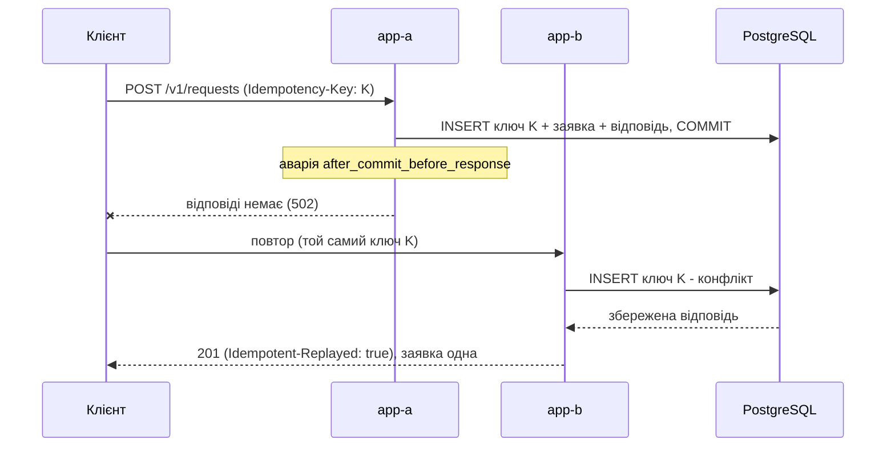
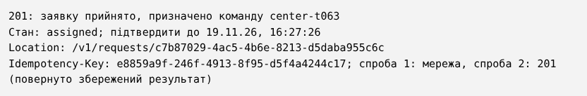
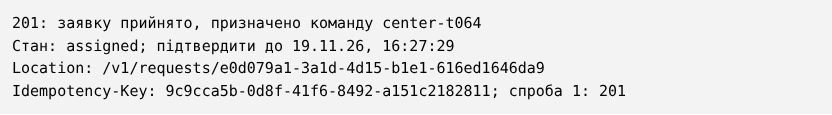

# Web ЛР2. Конкуренція та повторення запитів: докладно

Скорочений опис і таблиця пунктів - [README.md](../../README.md), розділ 6.1. Тут - механізм, повні результати й межі.

## Повтор після втраченої відповіді



## Механізм

**Інваріант (О2.1).** Правило «є вільна команда району» стосується кількох рядків (лічильник району й команди),
тому атомарний умовний `UPDATE` одного рядка його не охоплює, а SERIALIZABLE вимагав би повторів після
помилок 40001. `SELECT … FOR UPDATE` рядка `district_teams` серіалізує призначення в межах району й однаково
працює з обох екземплярів Web і з DPC.

**Ідемпотентність (О2.2).** `Idempotency-Key` (8-128 символів) обов'язковий для `POST /v1/requests`. Відбиток
запиту - SHA-256 канонічного JSON (ключі відсортовано, без пробілів). Ключ, заявка й збережена відповідь
фіксуються в одній транзакції (`migrations/003_idempotency.sql`), тому «ключ є, а заявки немає» неможливо.
Той самий ключ і те саме тіло - збережена відповідь (`Idempotent-Replayed: true`); інше тіло - `422`; ключ
ще обробляється - `409` з `Retry-After`. Прострочені (24 год) ключі видаляються порціями по 500 з
`FOR UPDATE SKIP LOCKED`.

**Втрачена відповідь (О2.3).** Керована відмова `fault("after_commit_before_response")` завершує процес
після `COMMIT`, до відповіді. Прапорець одноразовий, Docker перезапускає процес.

**Клієнт (О2.4).** `callWithRetry` повторює запит із тим самим ключем: експоненційна пауза з повним
jitter, не раніше `Retry-After`; статуси 502, 503, 504 повторюються й коли тіло - HTML (PC-1). Після 4 спроб -
«результат невідомий».

## Результати

| Перевірка | Результат | Свідчення |
|---|---|---|
| 10 заявок на 3 команди, 5 раундів, app-a й app-b | щоразу 3×201, 7×409, 3 різні команди, `busy` = 3 | `race.json` |
| Ідемпотентність | без ключа 400; повтор через інший екземпляр - та сама відповідь; інше тіло 422; ключ в обробленні 409 + `Retry-After`; 5 одночасних дублікатів - одна заявка | `idempotency.json` |
| Очищення | 1200 прострочених ключів прибрано порціями по 500 | `idempotency.json` |
| Втрачена відповідь | перша спроба - 502, повтор через app-b - 201 зі збереженої відповіді, заявка одна | `lost-response.json` |
| Клієнт | 502 → 201 з тим самим ключем; сервер недоступний - «результат невідомий після 4 спроб за 595 мс» | `client-retry.txt` |





## Як відтворити

```bash
python experiments/web_lr2_race.py --rounds 5
python experiments/web_lr2_idempotency.py
docker compose exec app-a touch /faults/after_commit_before_response
node web/client/tests/retry.test.mjs
```

## Межі

Ключ ідемпотентності захищає лише повтор із тим самим ключем: повтор із новим ключем створить другу заявку,
тому клієнт тримає один ключ на всі спроби. Ключ живе 24 години.
